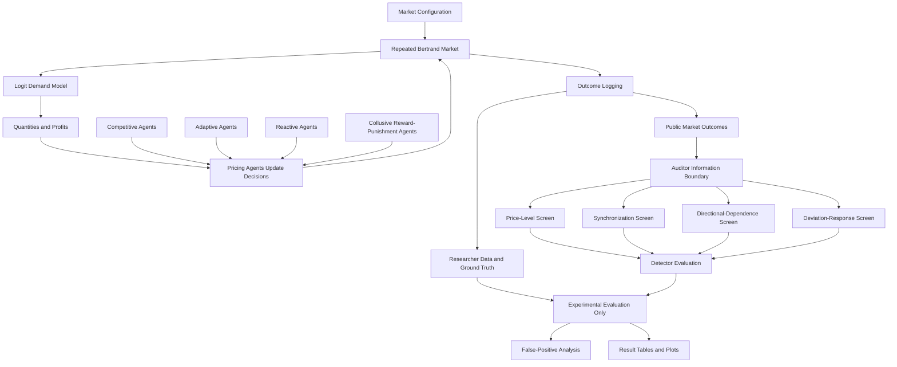
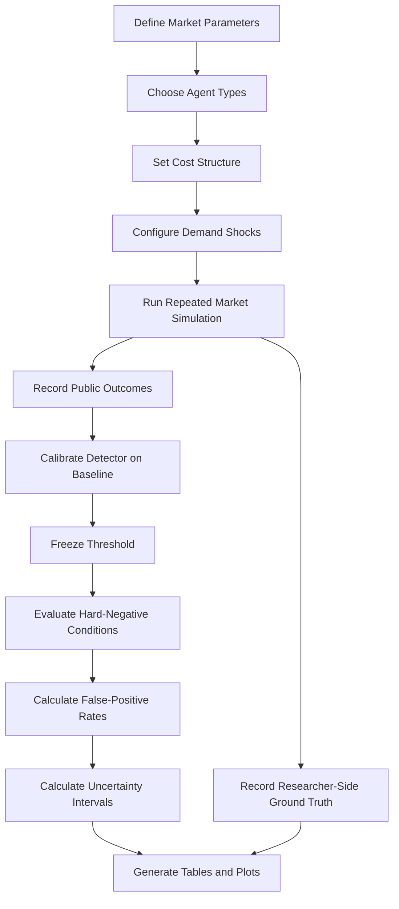

# Outcome-Only Collusion Detection Under Hidden Cost Asymmetry and Demand Shocks

**Research project:** Robustness of Outcome-Only Collusion Screens under Hidden Cost Asymmetry and Demand Shocks

**Institution:** Dr. Shyama Prasad Mukherjee International Institute of Information Technology, Naya Raipur (IIIT-NR)

**Research team:** Justin Santosh, Shreya Dubey, and Tanmay Kumar

**Supervisor:** Dr. Om Prakash Vyas

**Repository:** https://github.com/shreya801994/outcome-only-collusion-detection

---

## Table of Contents

- [1. Overview](#1-overview)
- [2. Research Motivation](#2-research-motivation)
- [3. Problem Statement](#3-problem-statement)
- [4. Research Questions](#4-research-questions)
- [5. Research Objectives](#5-research-objectives)
- [6. Proposed Approach](#6-proposed-approach)
- [7. System Architecture](#7-system-architecture)
- [8. Experimental Pipeline](#8-experimental-pipeline)
- [9. Mathematical Formulation](#9-mathematical-formulation)
- [10. Collusion Detection Screens](#10-collusion-detection-screens)
- [11. Experimental Design](#11-experimental-design)
- [12. Current Preliminary Results](#12-current-preliminary-results)
- [13. Technology Stack](#13-technology-stack)
- [14. Repository Structure](#14-repository-structure)
- [15. Installation and Setup](#15-installation-and-setup)
- [16. Running the Experiments](#16-running-the-experiments)
- [17. Testing and Validation](#17-testing-and-validation)
- [18. Reproducibility and Data Integrity](#18-reproducibility-and-data-integrity)
- [19. Limitations](#19-limitations)
- [20. Future Research Directions](#20-future-research-directions)
- [21. Research Significance](#21-research-significance)
- [22. References and Related Work](#22-references-and-related-work)
- [23. Research Disclaimer](#23-research-disclaimer)

---

## 1. Overview

Pricing algorithms and autonomous AI agents increasingly make repeated decisions in markets where competitors can observe one another's actions. In repeated markets, agents may learn to maintain prices above competitive levels through adaptive behavior, even without explicit communication or a written agreement.

This creates a difficult problem for competition authorities: **high prices are observable, but the reasons behind them may not be.**

A firm may charge a high price because it is coordinating with a competitor, because its marginal production cost is higher, or because market demand has changed. A screening mechanism that interprets every high price as evidence of collusion can therefore incorrectly flag legitimate competitive behavior.

This project develops a controlled simulation framework for evaluating the reliability of **outcome-only collusion screens** under hidden cost asymmetry, demand shocks, and adaptive competitive behavior.

The simulated market uses repeated differentiated-product Bertrand competition with multinomial logit demand. Firms choose prices, consumers allocate demand across products, and firms receive profits based on their prices, marginal costs, and quantities sold.

The auditor is deliberately restricted to public market outcomes, such as prices, quantities, and time. Firm-specific costs and simulation ground-truth labels are maintained separately and are not supplied to the auditor's detection logic.

The project evaluates screens based on:

- Price levels.
- Price synchronization.
- Directional dependence between competitors' prices.
- Responses to price deviations.
- Additional public-outcome information, including quantities, where implemented in the evaluation pipeline.

The central objective is to determine when these screens generate false alarms and how their reliability changes when the competitive environment becomes more realistic.

### Core research principle

> A market outcome that is consistent with collusion is not necessarily proof of collusion.

The research investigates this distinction experimentally rather than assuming that elevated prices, similar prices, or correlated price movements establish anticompetitive coordination.

---

## 2. Research Motivation

### 2.1 Algorithmic pricing and repeated interaction

In a repeated market, firms make pricing decisions over multiple periods. Each firm may observe previous market outcomes and use those observations to adjust its next price.

Repeated interaction creates the possibility of strategic behavior. For example, a firm may increase its price and maintain it if competitors do the same. Alternatively, it may reduce its price to attract demand and respond to a competitor's undercutting.

Learning-based agents can discover complex pricing policies through repeated interaction. These policies can sometimes produce prices above one-shot competitive equilibrium without requiring explicit communication between firms.

This creates a regulatory challenge because observed behavior may be generated by algorithms whose decision rules are difficult to inspect.

### 2.2 The problem with high-price detection

Consider a simplified market with two firms.

- Firm A has a marginal cost of \(1.0\).
- Firm B has a marginal cost of \(1.6\).

Even when both firms compete independently, Firm B may rationally charge a higher price because it faces a higher cost.

Now consider a different market in which both firms have equal costs but coordinate their pricing behavior to sustain elevated prices.

The observed price of Firm B might be similar in both markets, even though the underlying strategic behavior differs.

A screen based only on the price level may not distinguish these situations.

### 2.3 Demand shocks create another source of ambiguity

Market demand can change because of external events, changes in consumer preferences, seasonality, or other common influences.

If both firms react to the same demand shock, their prices may move together. This synchronized movement could resemble strategic coordination even when each firm independently responds to market conditions.

A detector that treats synchronization as sufficient evidence of collusion may therefore generate false positives.

### 2.4 Why outcome-only auditing matters

In many practical settings, an auditor cannot directly inspect:

- A firm's true marginal production cost.
- Its internal optimization objective.
- Its complete pricing algorithm.
- Its private training data.
- Its internal model state.
- Its private reasoning or proprietary decision rules.

The auditor may only have access to observable market data.

This project therefore treats collusion detection as an **information-constrained auditing problem** rather than a problem in which the regulator already knows the correct competitive benchmark for every firm.

---

## 3. Problem Statement

Let a market contain two firms repeatedly setting prices for differentiated products.

The firms have potentially asymmetric marginal costs, and the market may experience demand shocks. Their pricing policies may be competitive, adaptive, or explicitly designed to sustain high prices through reward-and-punishment behavior.

The regulator observes public outcomes but does not observe firm-specific costs or the internal decision rules that generated those outcomes.

The problem is to evaluate whether outcome-only detection screens can identify suspicious pricing patterns without incorrectly flagging legitimate competitive behavior.

Formally, let the public observation at period \(t\) be

\[
o_t = (p_{1,t},p_{2,t},q_{1,t},q_{2,t},t),
\]

where:

- \(p_{i,t}\) is the price charged by firm \(i\).
- \(q_{i,t}\) is the quantity sold by firm \(i\).
- \(t\) is the time period.

The auditor receives the public sequence

\[
O_{1:T} = (o_1,o_2,\ldots,o_T).
\]

The hidden state may contain

\[
h_t = (c_1,c_2,\theta,\mathcal{P}_1,\mathcal{P}_2,z_t),
\]

where \(c_i\) represents marginal cost, \(\theta\) represents market parameters, \(\mathcal{P}_i\) represents the firm's pricing policy, and \(z_t\) represents the demand-shock state.

These hidden variables are used by the simulator to generate outcomes, but they are not provided to the auditor's screening logic.

The research objective is to evaluate a detector

\[
D(O_{1:T}) \in \{0,1\},
\]

where \(D=1\) indicates that the observed market is flagged as suspicious.

The detector must be evaluated against known simulation conditions to determine how often it flags genuinely competitive behavior.

**Important distinction:** A screen produces a risk signal. It does not independently establish a legal violation or prove that firms coordinated.

---

## 4. Research Questions

The project is organized around the following questions.

### RQ1: Hidden cost asymmetry

How does the false-positive rate of an outcome-only collusion screen change when competing firms have different marginal costs?

### RQ2: Demand shocks

Can common demand shocks generate price movements that resemble collusive synchronization?

### RQ3: Adaptive competition

Do competitive agents that react strategically to previous prices produce patterns that are incorrectly interpreted as collusion?

### RQ4: Detector comparison

How do price-level, synchronization, directional-dependence, and deviation-response screens behave under the same information restrictions?

### RQ5: Information value

Can combining prices and quantities improve screening reliability compared with relying on price levels alone?

### RQ6: Robustness and generalization

Can conclusions obtained from the current simulated market be reproduced across independent runs, alternative parameter values, and more complex pricing-agent architectures?

These questions separate detector performance from the underlying economic mechanisms that generate market outcomes.

---

## 5. Research Objectives

The main objectives are:

1. Build a repeated differentiated-product Bertrand market simulator.
2. Model consumer demand using a multinomial logit specification.
3. Support firms with symmetric and asymmetric marginal costs.
4. Implement competitive, adaptive, reactive, and collusive pricing behaviors.
5. Simulate common demand shocks and evaluate their effects on market outcomes.
6. Maintain a strict boundary between the auditor's observable data and hidden simulation information.
7. Implement and compare multiple outcome-only detection screens.
8. Calibrate a screening threshold on a baseline and evaluate it on separate hard-negative conditions.
9. Measure false-positive behavior under cost asymmetry and other competitive conditions.
10. Validate market calculations, agent behavior, detector implementations, and simulation components through automated tests.
11. Preserve experimental data and scripts to support reproducibility.
12. Identify the limits of outcome-only screening and develop a basis for future research.

---

## 6. Proposed Approach

The project uses a simulation-based experimental methodology.

Rather than training a single classifier and reporting its accuracy on an arbitrary dataset, the framework constructs controlled market conditions where the underlying strategic behavior is known to the simulator.

The experimental design separates two types of conditions.

### 6.1 Positive controls

Positive controls represent market conditions in which the simulator explicitly implements collusive behavior.

One implemented example is reward-and-punishment pricing behavior. Firms maintain elevated prices and react to deviations in ways intended to discourage undercutting.

These conditions provide a test of whether a detector responds to a known collusive mechanism.

### 6.2 Hard negatives

Hard negatives represent competitive or non-collusive behavior that may nevertheless look suspicious from public outcomes.

The project includes conditions involving:

- Symmetric-cost competition.
- Asymmetric marginal costs.
- Reactive competitive pricing.
- Adaptive competitive pricing.
- Common demand shocks.
- Heterogeneous conditions involving costs and demand shocks.

Hard negatives are essential because a detector that flags only obvious competitive cases as safe may appear effective while being unreliable in realistic markets.

### 6.3 Frozen-threshold evaluation

The main evaluation principle is to calibrate a detector threshold on a designated baseline and keep that threshold fixed while testing harder conditions.

If the threshold is recalibrated independently for every cost gap, the experiment can hide the very sensitivity it is intended to measure.

For example, if a detector is calibrated on symmetric-cost competition, the same threshold should be applied to asymmetric-cost runs to determine whether the detector begins producing false alarms.

This makes the evaluation a robustness test rather than a sequence of unrelated classification problems.

### 6.4 Controlled comparisons

The simulator changes selected conditions while keeping other settings fixed wherever possible.

This allows observed changes in false-positive rates to be associated with particular experimental conditions, subject to the design's assumptions and stochastic variability.

The project emphasizes controlled simulation evidence. Results from the simulator should not automatically be interpreted as estimates of the frequency of collusion in real markets.

---

## 7. System Architecture

The system is divided into six logical layers.

1. Market environment.
2. Pricing agents.
3. Simulation and outcome logging.
4. Auditor information boundary.
5. Detection screens.
6. Experimental evaluation and reporting.

### 7.1 Architecture diagram



The researcher-side information is retained for experimental validation. It must not be used as an input feature by the outcome-only auditor.

### 7.2 Market environment

The market environment executes one period of price competition.

It receives the prices selected by the firms, computes consumer demand, calculates quantities and profits, and returns the resulting market outcomes.

The market layer is responsible for the economic calculations. It should not decide whether a market is collusive.

### 7.3 Pricing agents

Pricing agents represent different mechanisms for selecting prices.

The project includes agent modules for competitive behavior, adaptive behavior, reactive behavior, and explicitly collusive reward-and-punishment behavior.

These categories are used to generate distinct experimental conditions.

The precise strategy implemented by an agent is determined by its code, not merely by its category name. An adaptive or reactive agent should not automatically be assumed to be collusive.

### 7.4 Simulation and logging

The simulation layer repeatedly executes market periods and records outcomes.

The logs support later analysis of:

- Price trajectories.
- Quantity trajectories.
- Profit trajectories.
- Responses to price changes.
- Effects of asymmetric costs.
- Effects of demand shocks.

The researcher-side logs may also retain hidden costs and experimental labels for validation.

### 7.5 Auditor information boundary

The auditor layer restricts the information passed to detection screens.

A screen may use the permitted price and quantity history, but it must not access hidden costs or the ground-truth experimental label.

This separation is essential. If a detector receives the cost gap or the known strategy label, the experiment no longer measures outcome-only screening.

### 7.6 Detection and evaluation

Each detector extracts a different type of signal from the public history.

The evaluation scripts apply the detectors to logged market outcomes and compare their outputs with the known experimental conditions.

The final reports summarize detector behavior across baseline, asymmetric-cost, adaptive, reactive, and demand-shock scenarios.

---

## 8. Experimental Pipeline

The end-to-end workflow is:



### Step 1: Define the market

Configure product quality, marginal costs, price sensitivity, and the number of periods.

### Step 2: Select pricing behavior

Choose the agent configuration corresponding to the experimental condition.

### Step 3: Introduce the treatment

Examples include a nonzero cost gap, a demand shock, or a reactive competitive policy.

### Step 4: Run the simulation

The firms repeatedly choose prices and the market computes quantities and profits.

### Step 5: Log the observations

Store the public outcomes separately from hidden variables and ground-truth labels.

### Step 6: Calibrate the detector

Use a designated baseline dataset to select the screening threshold.

### Step 7: Freeze the threshold

Do not change the threshold for the hard-negative evaluation conditions.

### Step 8: Evaluate the hard negatives

Apply the detector to competitive runs involving cost asymmetry, shocks, or adaptive behavior.

### Step 9: Calculate performance metrics

Calculate the false-positive rate and, where positive controls are available, detection sensitivity.

### Step 10: Report the findings

Save result tables, confidence intervals, plots, and the scripts required to reproduce them.

---

## 9. Mathematical Formulation

This section presents the economic model underlying the experiments. Exact parameter values should always be taken from the corresponding implementation and experiment configuration.

### 9.1 Repeated differentiated-product Bertrand competition

Consider two firms indexed by \(i\in\{1,2\}\). Each firm chooses a price in period \(t\):

\[
p_{i,t} \in \mathcal{P},
\]

where \(\mathcal{P}\) is the feasible price set.

Both firms sell differentiated products. Consumers do not necessarily view the products as perfect substitutes, so a firm may retain some demand even when its competitor charges a lower price.

The firms compete repeatedly over \(T\) periods.

At the start of each period, the agents select prices according to their respective policies. The market then computes demand and profit.

### 9.2 Multinomial logit demand

Consumer demand is represented using a multinomial logit model.

Let:

- \(a_i\) denote the quality or attractiveness parameter of product \(i\).
- \(p_{i,t}\) denote its price.
- \(\mu>0\) denote the demand sensitivity or differentiation parameter.
- \(a_0\) denote the outside-good attractiveness parameter.

The utility index for product \(i\) is

\[
V_{i,t}=\frac{a_i-p_{i,t}}{\mu}.
\]

The quantity or market share allocated to product \(i\) is

\[
q_{i,t} =
\frac{\exp(V_{i,t})}
{\exp(a_0/\mu)+
 \sum_{j=1}^{2}\exp(V_{j,t})}.
\]

Equivalently,

\[
q_{i,t} =
\frac{\exp((a_i-p_{i,t})/\mu)}
{\exp(a_0/\mu)+
 \sum_{j=1}^{2}\exp((a_j-p_{j,t})/\mu)}.
\]

If quantities represent normalized market shares, then

\[
q_{0,t}+q_{1,t}+q_{2,t}=1,
\]

where \(q_{0,t}\) is the outside-good share.

**Interpretation:**

- A higher product price generally reduces its own demand.
- A more attractive product generally receives a larger share.
- The outside good captures consumers who do not purchase either product.
- The parameter \(\mu\) controls how strongly prices influence relative attractiveness.

The implementation's exact demand formula and parameterization are authoritative. If total market size is introduced, the normalized share must be multiplied by that market size to obtain quantities.

### 9.3 Marginal costs and profit

Let \(c_i\) denote firm \(i\)'s marginal cost.

The per-period operating profit is

\[
\pi_{i,t}=(p_{i,t}-c_i)q_{i,t}.
\]

Here:

- \(p_{i,t}-c_i\) is the unit margin.
- \(q_{i,t}\) is the quantity sold.
- \(\pi_{i,t}\) is the resulting operating profit.

A higher price does not necessarily imply a higher profit. The price increase may reduce demand sufficiently to offset the additional margin.

For a horizon of \(T\) periods, the undiscounted cumulative profit is

\[
\Pi_i=\sum_{t=1}^{T}\pi_{i,t}.
\]

If a discount factor \(\delta\) is used in a particular experiment, the discounted objective becomes

\[
\Pi_i^{\delta}
=\sum_{t=1}^{T}\delta^{t-1}\pi_{i,t}.
\]

The discounted expression is a general repeated-game formulation; it should only be described as the implemented objective when the agent code actually uses it.

### 9.4 Hidden cost asymmetry

Let the marginal costs be

\[
c_1=c,\qquad c_2=c+\Delta c,
\]

where \(\Delta c\) is the cost gap.

When

\[
\Delta c=0,
\]

the firms have symmetric marginal costs.

When

\[
\Delta c>0,
\]

Firm 2 has a higher marginal cost than Firm 1.

The cost gap is known to the researcher configuring the experiment but hidden from the auditor.

The project evaluates cost gaps including

\[
\Delta c \in \{0,\ 0.1,\ 0.3,\ 0.6\}.
\]

These values define experimental conditions, not universal economic categories.

The central issue is that a higher cost may rationally change a firm's equilibrium price. A detector that ignores this possibility may mistake competitive pricing for collusive pricing.

### 9.5 Bertrand-Nash equilibrium

In the one-shot competitive game, each firm chooses a price to maximize its own profit given the rival's price.

The best response of firm \(i\) can be written as

\[
BR_i(p_j)
=
\arg\max_{p_i\in\mathcal{P}}
(p_i-c_i)q_i(p_i,p_j).
\]

A Bertrand-Nash equilibrium \(p^N=(p_1^N,p_2^N)\) satisfies

\[
p_1^N\in BR_1(p_2^N),
\qquad
p_2^N\in BR_2(p_1^N).
\]

Neither firm can improve its one-period profit by unilaterally changing its price, holding the rival's price fixed.

The project includes a competitive-equilibrium reference table for the tested cost gaps. These reference prices help validate the market implementation and characterize the competitive benchmark.

The equilibrium is a theoretical benchmark for the simulation. It is not automatically observable to an auditor in a real market with unknown costs and unknown demand parameters.

### 9.6 Joint-profit maximization

A collusive benchmark can be constructed by maximizing the firms' combined profit:

\[
p^M\in
\arg\max_{p_1,p_2}
\left[
(p_1-c_1)q_1(p_1,p_2)
+
(p_2-c_2)q_2(p_1,p_2)
\right].
\]

This benchmark represents joint-profit maximization under the specified demand model. It does not imply that firms can legally or practically achieve it.

The difference between the competitive and joint-profit-maximizing outcomes provides context for evaluating how elevated prices arise in the simulator.

### 9.7 Common demand shocks

Let \(z_t\) denote a common demand shock.

A general demand model can be written as

\[
q_{i,t}=q_i(p_{1,t},p_{2,t};z_t).
\]

For example, a shock may change the attractiveness of both products or the attractiveness of the outside option.

A common shock can cause both firms to change prices in the same direction, even if their decisions are independent.

This is important because a detector that measures only price correlation may confuse a shared external cause with strategic dependence.

The precise shock process, magnitude, duration, and persistence are experiment-specific and should be read from the corresponding shock implementation.

### 9.8 Adaptive pricing

An adaptive agent updates its decision rule using information from previous periods.

A general representation is

\[
p_{i,t}
=
\mathcal{P}_i(H_{i,t}),
\]

where \(H_{i,t}\) is the history available to agent \(i\), and \(\mathcal{P}_i\) is its pricing policy.

For a reactive competitor, the policy may depend explicitly on the rival's previous price:

\[
p_{i,t}=f_i(p_{i,t-1},p_{j,t-1},H_{i,t}).
\]

These expressions describe general policy structures, not a claim that every implemented agent uses precisely these arguments.

Adaptation is not synonymous with collusion. A firm may respond strategically to its competitor while remaining independently competitive.

### 9.9 Reward-and-punishment behavior

A reward-and-punishment strategy attempts to sustain elevated prices by making deviations less attractive.

Conceptually, a firm may maintain a target price during cooperative-looking periods and respond to a detected undercut with a temporary price reduction or another punishment policy.

A simplified policy representation is

\[
p_{i,t}=
\begin{cases}
p_i^{H}, & \text{if the cooperative state is maintained},\\
p_i^{P}, & \text{if a deviation triggers punishment},
\end{cases}
\]

where \(p_i^{H}\) is the high target price and \(p_i^{P}\) is the punishment price.

This equation is an illustrative representation of the strategic mechanism. The actual transition rules and prices are defined by the collusive-agent implementation.

### 9.10 The information-constrained detection problem

Let the complete public history be \(O_{1:T}\). A detector maps this history to a score:

\[
s_k=S_k(O_{1:T}),
\]

where \(S_k\) is detector \(k\).

For a threshold \(\tau_k\), the binary screening decision is

\[
D_k(O_{1:T})=
\mathbf{1}\{s_k\geq\tau_k\}.
\]

Here \(\mathbf{1}\{\cdot\}\) is an indicator function equal to one when the condition holds and zero otherwise.

The threshold determines how sensitive the detector is to suspicious outcomes. A lower threshold generally produces more flags, potentially including more false positives.

The objective is not simply to maximize the number of flagged markets. It is to evaluate the trade-off between identifying positive controls and avoiding false alarms on hard negatives.

### 9.11 False-positive rate

For a known competitive condition, let:

- \(N_{\mathrm{FP}}\) be the number of competitive runs incorrectly flagged.
- \(N_{\mathrm{C}}\) be the total number of competitive runs evaluated.

The false-positive rate is

\[
\operatorname{FPR}
=
\frac{N_{\mathrm{FP}}}{N_{\mathrm{C}}}.
\]

For cost gap \(\Delta c\),

\[
\operatorname{FPR}(\Delta c)
=
\frac{
\sum_{r=1}^{N}
\mathbf{1}\{D(O^{(r)})=1\}
}{
N
},
\]

where all \(N\) evaluated runs belong to the competitive condition with that cost gap.

The notation makes the evaluation unit explicit: a run-level false-positive rate should count independently generated market runs, not treat every time period from the same run as an independent experiment.

### 9.12 Detection sensitivity

For a positive-control condition containing \(N_{\mathrm{P}}\) known collusive runs, the detection sensitivity is

\[
\operatorname{TPR}
=
\frac{N_{\mathrm{TP}}}{N_{\mathrm{P}}},
\]

where \(N_{\mathrm{TP}}\) is the number of positive-control runs correctly flagged.

A detector with a high false-positive rate may achieve high sensitivity simply by flagging nearly everything. FPR and TPR should therefore be reported together.

### 9.13 Confidence intervals

For a simple binomial run-level outcome, a Wilson interval can be used to quantify uncertainty in an estimated rate.

Let \(\hat p=x/n\), where \(x\) is the number of positive outcomes among \(n\) independent runs, and let \(z\) be the relevant normal quantile.

The Wilson interval is

\[
\frac{
\hat p+\frac{z^2}{2n}
\ \pm
z\sqrt{\frac{\hat p(1-\hat p)}{n}
+\frac{z^2}{4n^2}}
}{
1+\frac{z^2}{n}
}.
\]

The interval does not correct for dependence between observations. If the evaluation treats periods from the same run as independent samples, the uncertainty estimate may be misleading. Independent simulation runs, or an appropriate run-level resampling procedure, are preferable.

---

## 10. Collusion Detection Screens

The project implements multiple screens that capture different observable patterns.

The detectors are complementary: each looks for a different signal and each has potential failure modes.

### 10.1 B0: Price-level screen

**Module:** `detectors/price_level.py`

The price-level screen evaluates whether observed prices are unusually high relative to a specified baseline or threshold.

A general form is

\[
s_{B0}=S_{\mathrm{level}}(O_{1:T}).
\]

The detector flags the market when

\[
s_{B0}\geq\tau_{B0}.
\]

The exact score construction and aggregation rule are defined in the detector module.

**Potential strength**

- Simple to interpret.
- Useful as a baseline.
- Can detect markets whose observed prices are far above a calibrated reference.

**Main limitation**

High prices can arise from high marginal costs, changed demand conditions, or other legitimate factors. A price-level screen cannot establish the cause of the observed prices.

**Research role**

B0 is a baseline screen for studying whether hidden cost asymmetry causes false alarms under a fixed threshold.

### 10.2 B1: Price-synchronization screen

**Module:** `detectors/synchronization.py`

The synchronization screen examines whether firms' prices move together over time.

A conceptual measure is the association between price changes:

\[
\Delta p_{i,t}=p_{i,t}-p_{i,t-1}.
\]

A generic synchronization statistic could examine

\[
\operatorname{Corr}(\Delta p_{1,t},\Delta p_{2,t}),
\]

although the exact statistic used by the implementation must be taken from the detector code.

**Potential strength**

Synchronization may reveal coordinated-looking movements that a simple price-level screen misses.

**Main limitation**

Common demand shocks, common costs, and similar competitive responses can also produce synchronized prices.

Correlation alone does not establish that one firm strategically followed or coordinated with the other.

### 10.3 B2: Directional-dependence screen

**Module:** `detectors/directional_dependence.py`

Directional dependence examines whether movements in one firm's price are associated with subsequent movements in the rival's price.

A conceptual lagged relationship is

\[
\Delta p_{2,t}
=
\alpha+\beta\Delta p_{1,t-1}+\varepsilon_t.
\]

A nonzero estimate of \(\beta\) can indicate predictive dependence in this simplified model. It does not, by itself, prove causation or collusion.

The actual detector's feature construction, statistical procedure, and threshold are defined by its implementation.

**Potential strength**

The direction and timing of price movements can provide information beyond contemporaneous correlation.

**Main limitation**

A common shock with different response delays can create apparent directional dependence. So can independent firms using similar public information or responding to the same market conditions.

### 10.4 B3: Deviation-response screen

**Module:** `detectors/deviation_response.py`

The deviation-response screen examines behavior around a price deviation.

A conceptual sequence is:

1. One firm's price changes substantially.
2. The rival observes or reacts to the new market condition.
3. The rival's subsequent pricing behavior is recorded.
4. The detector evaluates whether the response resembles the specified suspicious pattern.

The score can be represented generally as

\[
s_{B3}=S_{\mathrm{response}}(O_{1:T}).
\]

The precise event definition, response window, scoring rule, and threshold must be taken from the implementation.

**Potential strength**

Response patterns may reveal behavior that cannot be detected from average prices alone.

**Main limitation**

Competitive firms also react to undercutting, lost demand, and rival price changes. A response to a deviation is not inherently collusive.

### 10.5 Quantity information

The market records quantities alongside prices. Quantities can help distinguish some situations that appear similar when only prices are considered.

For example, a price increase accompanied by a change in demand may be consistent with several different economic mechanisms.

A future or extended detector could evaluate a joint feature vector:

\[
x_t=(p_{1,t},p_{2,t},q_{1,t},q_{2,t}).
\]

However, quantity information is not a universal solution. Different combinations of demand, costs, and preferences can generate similar prices and quantities.

The value of adding quantities must be established experimentally. It should not be assumed merely because more variables are available.

### 10.6 Why multiple screens matter

The screens can fail for different reasons:

| Screen | Signal examined | Example of a competing explanation |
|---|---|---|
| B0 | Elevated price levels | Higher marginal costs |
| B1 | Similar price movements | Common demand shock |
| B2 | Lagged directional dependence | Different reaction times to shared information |
| B3 | Response to deviations | Ordinary competitive reaction to undercutting |
| Quantity-based analysis | Joint price and quantity patterns | Unobserved demand or preference changes |

Combining signals may improve screening, but only if the combined method is calibrated and tested on the same hard-negative conditions. Multiple weak signals do not automatically become strong evidence when added together.

---

## 11. Experimental Design

### 11.1 Baseline competitive market

The baseline establishes the behavior of the simulator under symmetric costs and the selected competitive-agent policy.

It is used for validating the market and, where specified, calibrating the price-level threshold.

### 11.2 Cost-asymmetry experiments

The project evaluates several cost gaps:

\[
\Delta c\in\{0,0.1,0.3,0.6\}.
\]

The intended comparison holds the detection threshold fixed while the competitive cost structure changes.

The central measurement is

\[
\operatorname{FPR}(\Delta c).
\]

If the false-positive rate increases with the cost gap, this indicates that the detector is sensitive to a factor that can also arise under competitive behavior.

The result would not mean that every high-cost firm is incorrectly flagged in real markets. It would show a limitation under the specified simulated conditions.

### 11.3 Demand-shock experiments

Demand-shock experiments introduce external variation into the market.

These experiments test whether price synchronization and other screening signals remain reliable when firms independently react to shared market conditions.

Important design variables include:

- Shock magnitude.
- Shock timing.
- Shock duration.
- Shock persistence.
- Whether the shock affects product attractiveness or the outside option.
- Whether agents observe the shock directly or infer it from outcomes.

The experiment code defines which of these variables are actually varied.

### 11.4 Reactive competitive experiments

Reactive agents change their behavior in response to prior market outcomes.

This creates hard negatives because their prices may exhibit strong dependence without being generated by the explicit collusive policy used in the positive controls.

The objective is to test whether the detector confuses strategic competition with reward-and-punishment collusion.

### 11.5 Dynamic and adaptive experiments

Adaptive experiments investigate whether a detector remains reliable when competitive agents update their behavior over time.

This matters because a detector tested only against static or simplistic competitors may learn to identify the simulator's agent categories rather than robust evidence of collusion.

### 11.6 Positive-control experiments

The collusive reward-and-punishment and deviation experiments provide known examples of the mechanisms the screens are intended to detect.

They support evaluation of detection sensitivity and the behavior of the screens around deviations.

A positive control is not proof that every form of real-world collusion follows the same pattern. It tests detection against a specific mechanism.

### 11.7 Calibration and evaluation separation

The threshold calibration and hard-negative evaluation must be separated.

A robust procedure is:

1. Generate baseline calibration runs.
2. Choose the threshold according to a declared calibration rule.
3. Save the selected threshold.
4. Freeze the threshold.
5. Generate or select independent evaluation runs.
6. Evaluate every hard-negative condition using that same threshold.
7. Report the run counts, rates, and uncertainty intervals.

The repository contains calibration data, a stored B0 threshold, and hard-negative evaluation outputs. The exact number of independent calibration and evaluation runs should be reported from the scripts and datasets used for each final experiment.

---

## 12. Current Preliminary Results

The repository contains a preliminary result summary for the B0 price-level screen under cost asymmetry.

The current stored summary reports the following:

| Cost gap \(\Delta c\) | Flagged competitive runs | Runs evaluated | Observed FPR |
|---:|---:|---:|---:|
| 0.0 | 2 | 100 | 2% |
| 0.1 | 100 | 100 | 100% |
| 0.3 | 100 | 100 | 100% |
| 0.6 | 100 | 100 | 100% |

These values are reported from the current `results/b0_fpr_summary.csv` artifact and should be verified against the final experiment scripts and run-generation protocol before formal publication.

### Interpretation

The stored results suggest a sharp failure mode for the price-level screen: the threshold that rarely flags the symmetric-cost baseline flags all evaluated runs at the tested positive cost gaps.

This pattern is consistent with the hypothesis that elevated competitive prices can be mistaken for collusion when the screen does not account for cost asymmetry.

However, the table alone does not establish that cost asymmetry is the only cause of the result. Before making a strong research claim, verify:

- The precise statistic used by B0.
- The threshold calibration procedure.
- Whether calibration and evaluation runs are independent.
- Whether seeds and run configurations vary as intended.
- Whether all runs use the same market and agent parameters apart from the treatment.
- Whether alternative dataset versions correspond to different experiment configurations.
- Whether the result is stable across additional independent runs.

The 100% observed false-positive rate is a result for the tested simulation conditions, not a universal statement about all price-level screens or all markets.

### Current repository artifacts

The current repository includes:

- `results/b0_fpr_summary.csv`
- `results/b0_fpr_vs_cost_gap.png`
- `results/b0_hard_negative_results.csv`
- `results/b0_threshold.txt`
- `results/detector_scores.csv`
- `results/dynamic_detector_scores.csv`
- `results/reactive_detector_scores.csv`
- `results/hard_negative_cost_asymmetry.png`

These artifacts should be interpreted alongside the corresponding experiment scripts and raw data.

### Reporting standard

Final results should include, at minimum:

- Number of independent runs per condition.
- Calibration dataset and threshold-selection rule.
- Frozen threshold value.
- False-positive rate by condition.
- Detection sensitivity on positive controls.
- Confidence intervals.
- Random seed policy.
- Relevant market parameters.
- Known limitations and alternative explanations.

A graph is useful for communicating a result. It is not a substitute for a reproducible experimental protocol.

---

## 13. Technology Stack

The current repository is a Python-based simulation and evaluation framework.

| Technology | Role |
|---|---|
| Python | Core implementation language |
| NumPy | Numerical computation |
| SciPy | Scientific computing and numerical routines |
| pandas | Experimental data processing and CSV handling |
| Matplotlib | Plotting and visualization |
| pytest | Automated testing |
| Git | Version control |
| GitHub | Repository hosting and collaboration |
| PowerShell | Local development workflow on Windows |

The current `requirements.txt` pins the following versions:

```text
numpy==2.5.3
pandas==3.0.6
scipy==1.18.1
matplotlib==3.11.2
pytest==9.1.1
```

The implementation should be run with a compatible Python environment. The development environment used for the recorded test run was Python 3.13.11.

**Scope clarification:** The current codebase is a Python economic simulation and detector framework. LLM-based pricing agents and production deployment are potential future extensions, not capabilities that should be inferred from the repository name or research motivation.

---

## 14. Repository Structure

The repository is organized around simulation, detection, experiments, evaluation, tests, data, and results.

```text
outcome-only-collusion-detection/
│
├── .gitignore
├── requirements.txt
│
├── simulator/
│   ├── __init__.py
│   ├── market.py
│   ├── simulation.py
│   ├── agents.py
│   ├── adaptive_agents.py
│   ├── reactive_agents.py
│   ├── collusion_agents.py
│   ├── auditor_view.py
│   └── shocks.py
│
├── detectors/
│   ├── __init__.py
│   ├── price_level.py
│   ├── synchronization.py
│   ├── directional_dependence.py
│   └── deviation_response.py
│
├── experiments/
│   ├── baseline_simulation.py
│   ├── asymmetric_cost_baseline.py
│   ├── competitive_cost_asymmetry.py
│   ├── demand_shock_baseline.py
│   ├── adaptive_demand_shock_baseline.py
│   ├── dynamic_competitive_experiment.py
│   ├── reactive_competitive_experiment.py
│   ├── reactive_competitive_shock_experiment.py
│   ├── collusion_baseline.py
│   ├── collusion_deviation.py
│   ├── calibrate_b0.py
│   ├── evaluate_b0_hard_negatives.py
│   ├── score_detectors.py
│   ├── score_dynamic_detectors.py
│   ├── score_reactive_conditions.py
│   ├── score_reactive_detectors.py
│   ├── score_b3_dynamic.py
│   ├── run_experiment.py
│   ├── plot_b0_fpr.py
│   └── plot_hard_negative.py
│
├── evaluation/
│   └── competitive_equilibrium_reference.csv
│
├── tests/
│   ├── test_market.py
│   ├── test_simulation.py
│   ├── test_agents.py
│   ├── test_adaptive_agents.py
│   ├── test_reactive_agents.py
│   ├── test_collusion_agents.py
│   ├── test_auditor_view.py
│   ├── test_detectors.py
│   ├── test_detector_package.py
│   └── test_shocks.py
│
├── data/
│   ├── auditor_trajectories.csv
│   ├── researcher_trajectories.csv
│   ├── b0_calibration_runs.csv
│   ├── dynamic_auditor_trajectories.csv
│   ├── dynamic_researcher_trajectories.csv
│   ├── reactive_auditor_trajectories.csv
│   ├── reactive_researcher_trajectories.csv
│   ├── reactive_shock_auditor_trajectories.csv
│   ├── reactive_shock_researcher_trajectories.csv
│   ├── competitive_baseline.csv
│   ├── competitive_cost_gap_0.0.csv
│   ├── competitive_cost_gap_0.1.csv
│   ├── competitive_cost_gap_0.3.csv
│   ├── competitive_cost_gap_0.6.csv
│   ├── competitive_demand_shocks.csv
│   ├── adaptive_competitive_demand_shocks.csv
│   ├── adaptive_heterogeneous_demand_shocks.csv
│   ├── collusive_reward_punishment.csv
│   ├── collusion_deviation_auditor.csv
│   ├── collusion_deviation_researcher.csv
│   └── collusive_deviation_response.csv
│
└── results/
    ├── b0_fpr_summary.csv
    ├── b0_fpr_vs_cost_gap.png
    ├── b0_threshold.txt
    ├── b0_hard_negative_results.csv
    ├── detector_scores.csv
    ├── dynamic_detector_scores.csv
    ├── reactive_detector_scores.csv
    └── hard_negative_cost_asymmetry.png
```

This is a logical overview of the committed project files. Exact filenames and generated artifacts can evolve as experiments are revised.

### Module responsibilities

**`simulator/market.py`**

Implements the market calculations, including demand, quantities, and profits.

**`simulator/simulation.py`**

Coordinates repeated market periods and collects simulation trajectories.

**`simulator/agents.py`**

Contains baseline agent behavior.

**`simulator/adaptive_agents.py`**

Contains adaptive pricing behavior.

**`simulator/reactive_agents.py`**

Contains reactive competitive behavior.

**`simulator/collusion_agents.py`**

Contains explicit collusive reward-and-punishment behavior.

**`simulator/shocks.py`**

Provides demand-shock functionality.

**`simulator/auditor_view.py`**

Defines the auditor-facing representation of market outcomes.

**`detectors/`**

Contains the implemented outcome-only screening modules.

**`experiments/`**

Contains experiment drivers, calibration routines, scoring scripts, and plotting utilities.

**`evaluation/`**

Contains the competitive-equilibrium reference values used for validation.

**`tests/`**

Contains automated checks for the simulator and detector components.

**`data/`**

Contains generated market trajectories, calibration data, and condition-specific datasets.

**`results/`**

Contains saved detector scores, summaries, thresholds, and figures.

---

## 15. Installation and Setup

### Prerequisites

- Python 3.13 or a compatible Python version.
- Git.
- Access to the repository.
- PowerShell, Command Prompt, or another terminal.

### Clone the repository

```bash
git clone https://github.com/shreya801994/outcome-only-collusion-detection.git
cd outcome-only-collusion-detection
```

### Create a virtual environment

On Windows PowerShell:

```powershell
python -m venv .venv
```

Activate it:

```powershell
.\.venv\Scripts\Activate.ps1
```

If PowerShell prevents activation because of its execution policy, use an approved local development workaround rather than changing system-wide security settings unnecessarily.

### Install dependencies

```powershell
python -m pip install --upgrade pip
python -m pip install -r requirements.txt
```

### Verify dependency consistency

```powershell
python -m pip check
```

The expected successful message is:

```text
No broken requirements found.
```

### Run the test suite

```powershell
python -m pytest
```

Using `python -m pytest` ensures pytest runs under the active Python interpreter.

---

## 16. Running the Experiments

Run commands from the repository root, with the virtual environment activated.

The following commands correspond to the experiment scripts currently present in the repository. Check each script's configuration before rerunning it, because some scripts overwrite generated CSVs or result files.

### 16.1 Baseline market simulation

```powershell
python -m experiments.baseline_simulation
```

Purpose:

- Run the baseline competitive market.
- Validate basic market behavior.
- Generate baseline output.

### 16.2 Cost-asymmetry baseline

```powershell
python -m experiments.asymmetric_cost_baseline
```

Purpose:

- Evaluate competitive pricing under different marginal costs.
- Generate cost-gap-specific trajectories.

### 16.3 Explicit cost-asymmetry experiment

```powershell
python -m experiments.competitive_cost_asymmetry
```

Purpose:

- Run the alternative cost-asymmetry experiment implementation.
- Generate the corresponding `_new.csv` datasets.

The two cost-asymmetry scripts have generated differently named datasets. Before treating these as interchangeable replications, verify their configurations, output columns, seeds, and numerical differences.

### 16.4 Demand-shock baseline

```powershell
python -m experiments.demand_shock_baseline
```

Purpose:

- Run competitive pricing under demand shocks.
- Record public and researcher-side outcomes as defined by the script.

### 16.5 Adaptive demand-shock experiment

```powershell
python -m experiments.adaptive_demand_shock_baseline
```

Purpose:

- Evaluate adaptive competitive behavior under demand-shock conditions.

### 16.6 Dynamic competitive experiment

```powershell
python -m experiments.dynamic_competitive_experiment
```

Purpose:

- Generate dynamic competitive trajectories for further detector analysis.

### 16.7 Reactive competitive experiment

```powershell
python -m experiments.reactive_competitive_experiment
```

Purpose:

- Generate reactive competitive trajectories.
- Evaluate hard negatives with strategic responses to previous outcomes.

### 16.8 Reactive competition with demand shocks

```powershell
python -m experiments.reactive_competitive_shock_experiment
```

Purpose:

- Evaluate the interaction between reactive competition and demand shocks.

### 16.9 Collusive reward-and-punishment baseline

```powershell
python -m experiments.collusion_baseline
```

Purpose:

- Generate outcomes from the explicitly collusive policy.
- Provide a positive-control condition.

### 16.10 Collusive deviation experiment

```powershell
python -m experiments.collusion_deviation
```

Purpose:

- Record market behavior around the configured deviation and response events.

### 16.11 Calibrate the B0 threshold

```powershell
python -m experiments.calibrate_b0
```

Purpose:

- Run the B0 calibration procedure.
- Save calibration data and the selected threshold.

**Caution:** This script may overwrite the existing calibration dataset or threshold file. Preserve the current version before rerunning it if you need to compare historical results.

### 16.12 Evaluate B0 on hard negatives

```powershell
python -m experiments.evaluate_b0_hard_negatives
```

Purpose:

- Apply the stored B0 threshold to the configured hard-negative data.
- Generate false-positive summaries.

Use the exact frozen threshold associated with the experiment. Do not recalibrate separately for each test condition.

### 16.13 Score the detector suite

```powershell
python -m experiments.score_detectors
```

Purpose:

- Evaluate detector scores on the configured trajectory data.

### 16.14 Score dynamic detectors

```powershell
python -m experiments.score_dynamic_detectors
```

Purpose:

- Evaluate detectors on dynamic competitive trajectories.

### 16.15 Score reactive conditions

```powershell
python -m experiments.score_reactive_conditions
```

Purpose:

- Evaluate configured reactive and demand-shock conditions.

### 16.16 Score reactive detectors

```powershell
python -m experiments.score_reactive_detectors
```

Purpose:

- Evaluate detector performance on reactive competitive trajectories.

Check the output paths before running scoring scripts: multiple scripts may write to the same results filename. Preserve previous results if you need a historical comparison.

### 16.17 Score the B3 dynamic experiment

```powershell
python -m experiments.score_b3_dynamic
```

Purpose:

- Score deviation-response behavior in the dynamic dataset.

### 16.18 Generate plots

```powershell
python -m experiments.plot_b0_fpr
```

```powershell
python -m experiments.plot_hard_negative
```

These scripts use saved experiment outputs to generate figures. Run the corresponding experiment and evaluation scripts first if the required files are absent or outdated.

---

## 17. Testing and Validation

Automated tests are important because a detector's results are meaningful only if the underlying simulator and calculations behave as intended.

The project includes tests for:

- Market calculations.
- Simulation behavior.
- Baseline agents.
- Adaptive agents.
- Reactive agents.
- Collusive agents.
- Auditor-facing data.
- Detector modules.
- Demand shocks.

### Current test status

The recorded development run completed with:

```text
52 passed
```

A separate dependency consistency check reported:

```text
No broken requirements found.
```

These are useful software-engineering checks, but they do not establish that the economic model is realistic or that the research conclusions are correct.

### Economic validation

The repository also includes:

```text
evaluation/competitive_equilibrium_reference.csv
```

The reference values can be used to compare the implemented market against expected competitive equilibrium prices for the specified cost gaps.

A rigorous validation procedure should check:

1. Demand shares are valid and sum to the expected total, including the outside good.
2. Quantities are nonnegative and finite.
3. Profits are calculated using the correct price, cost, and quantity.
4. The numerical competitive equilibrium matches the reference values within a declared tolerance.
5. Cost asymmetry affects the appropriate firms and is not accidentally reversed.
6. Demand shocks alter the intended market variables.
7. The auditor-facing representation does not expose hidden costs or labels.
8. Detector thresholds are not silently recalibrated during evaluation.
9. Repeated experiments use the intended random-seed policy.
10. Output files correspond to the script and configuration that generated them.

Passing unit tests does not automatically prove all these conditions. Each should be validated explicitly.

---

## 18. Reproducibility and Data Integrity

A central goal is to make it possible for another researcher to inspect the implementation, rerun the experiments, and understand the origin of each result.

### 18.1 Preserve the separation of information

The researcher-side data can contain information used to validate the simulation. The auditor-side data should contain only the permitted public observations.

This boundary should be enforced in the data pipeline and tested.

A detector should not gain access to ground-truth labels, marginal costs, or hidden agent types through a dataframe join or a shared configuration object.

### 18.2 Record experiment configurations

For each final run, record:

- Agent types.
- Market parameters.
- Cost gaps.
- Shock configuration.
- Number of periods.
- Number of independent runs.
- Random seeds.
- Detector versions.
- Threshold-calibration dataset.
- Threshold-selection rule.
- Output file paths.

These details should be preserved with the results rather than relying on memory or filenames alone.

### 18.3 Distinguish generated datasets

Two CSV files with similar names are not necessarily identical experiments.

Before comparing or merging datasets, inspect:

- Column names.
- Number of observations.
- Parameter values.
- Random seeds.
- Simulation initialization.
- Agent implementation.
- Numerical differences.
- Generation script and version.

The repository contains older and newer cost-asymmetry output files. These should remain distinguishable until their provenance is documented.

### 18.4 Preserve thresholds

The B0 threshold is part of the experimental protocol.

If a threshold is calibrated on one dataset, preserve its value and identify that dataset. Evaluation results should record which threshold was applied.

A result generated with a different threshold should be treated as a different evaluation.

### 18.5 Keep raw data and processed results separate

Raw trajectories should be preserved independently of detector score summaries and figures.

This permits researchers to recompute metrics, audit transformations, and investigate unexpected outcomes.

### 18.6 Reproducibility is more than running the same command

Exact reproduction can depend on software versions, random seeds, initial conditions, and numerical implementation details.

A complete research release should include the configuration and environment information required to reproduce the relevant experiment.

---

## 19. Limitations

The current project is a controlled simulation study. Several limitations must be acknowledged.

### 19.1 Simplified market structure

The current core environment is a two-firm differentiated-product market. Real markets may include more firms, capacity constraints, product entry, heterogeneous consumers, and other institutional features.

### 19.2 Model-dependent demand

Multinomial logit demand is analytically convenient, but real consumer demand may not follow this specification. Detector performance may change under alternative demand models.

### 19.3 Limited cost variation

The tested cost gaps cover selected values rather than the full range of possible cost distributions or cost dynamics.

### 19.4 Demand-shock specification

The results depend on the shock process used in the simulator. Other forms of demand variation may produce different price and quantity patterns.

### 19.5 Agent-policy dependence

The competitive, adaptive, reactive, and collusive agents represent particular decision rules. A detector may perform differently on pricing policies not represented in the experiments.

### 19.6 Observational ambiguity

Different economic mechanisms can produce similar observable outcomes. Prices and quantities may be insufficient to identify the underlying strategy uniquely.

### 19.7 Threshold dependence

A screen's false-positive rate depends on its score, threshold, calibration sample, and evaluation distribution.

A threshold that performs well on one baseline may fail when the market conditions change.

### 19.8 Statistical uncertainty

Simulation runs may not be independent if they reuse seeds, initial states, or deterministic trajectories.

Confidence intervals and significance tests must reflect the actual unit of independent variation.

### 19.9 Preliminary evidence

The current stored B0 results suggest a serious sensitivity to cost asymmetry under the tested conditions. Additional validation is needed before treating the pattern as a general finding.

### 19.10 No automatic real-world legal inference

The simulator does not establish that any particular real firm or market is colluding. A screening signal should not be interpreted as proof of an agreement, intent, or legal violation.

---

## 20. Future Research Directions

The following directions extend the current framework. They should be treated as proposed work unless corresponding implementations and results are added to the repository.

### 20.1 Robust threshold calibration

Evaluate multiple threshold-selection rules and test whether they retain their intended false-positive rate across held-out market conditions.

A particularly important test is calibration on symmetric-cost competition followed by evaluation on asymmetric-cost competition without recalibration.

### 20.2 Detector comparison under matched conditions

Compare B0, B1, B2, and B3 on the same independent runs, using a documented calibration protocol.

Report both false-positive rates and detection sensitivity rather than ranking detectors by a single aggregate score.

### 20.3 Combining observable signals

Investigate whether joint price and quantity features improve discrimination.

Any combined detector should be calibrated using training or calibration data and evaluated on independent runs to avoid overstating performance.

### 20.4 More realistic demand shocks

Evaluate shocks with different magnitudes, persistence, timing, and effects on consumer preferences.

This would help determine whether apparent coordination is driven by a particular shock design.

### 20.5 Alternative market structures

Extend the framework to markets with three or more firms, different levels of product differentiation, and other demand specifications.

### 20.6 Broader competitive-agent families

Introduce additional competitive policies to test whether detector performance depends on the particular reactive or adaptive strategy used in the current experiments.

### 20.7 Learning-based pricing agents

A future extension could integrate Q-learning or other reinforcement-learning pricing agents.

Such experiments should distinguish an agent's learning architecture from the strategic behavior it produces. A learning agent should not automatically be labelled collusive merely because it learns elevated prices.

### 20.8 LLM-based pricing agents

A further extension could evaluate large language model pricing agents in the same controlled market.

This would require documenting prompts, model versions, permitted information, price-action constraints, inference settings, and reproducibility limitations.

LLM-based agents are a proposed extension unless their implementation is added and evaluated.

### 20.9 Uncertainty-aware auditing

Instead of returning only a binary flag, future screens could estimate a calibrated risk score and communicate uncertainty.

A useful evaluation would examine whether such scores remain calibrated across changes in cost structure and demand conditions.

### 20.10 External validity

Ultimately, simulation findings should be compared with suitable empirical evidence or additional market models before making claims about real-world regulatory effectiveness.

---

## 21. Research Significance

The project focuses on a practical weakness in outcome-based auditing: suspicious market outcomes can have multiple explanations.

Its contribution is not to assume that a particular detector can reliably identify collusion. Instead, it provides a controlled environment in which the detector can be challenged using competitive cases designed to resemble collusive behavior.

The framework supports three important research goals.

**First, false-positive analysis.** It measures how often a detector flags known competitive behavior under specified conditions.

**Second, information-constrained evaluation.** It separates the information available to the auditor from hidden variables used by the simulator.

**Third, robustness testing.** It evaluates whether conclusions from a simple baseline remain valid under cost asymmetry, demand shocks, and adaptive competitive behavior.

The intended outcome is a more careful understanding of when outcome-only screens are informative, when they are unreliable, and which additional observable signals may be worth investigating.

---

## 22. References and Related Work

The following works provide background for the economic model and the study of algorithmic pricing. Verify the exact bibliographic metadata and cite the original publications in any formal paper.

1. **Calvano, E., Calzolari, G., Denicolò, V., and Pastorello, S.** “Artificial Intelligence, Algorithmic Pricing, and Collusion.” *American Economic Review*, 110(10), 3267–3297, 2020.  
   Relevance: Repeated pricing competition and the possibility that reinforcement-learning agents learn supra-competitive behavior without explicit communication.

2. **Bertrand competition and differentiated-product demand.** The project uses the differentiated-product Bertrand framework with multinomial logit demand as its economic foundation. The market implementation and equilibrium reference file define the specific model used here.

3. **Research on algorithmic collusion and competition-policy screening.** Related literature examines how algorithms can affect market outcomes, how tacit coordination may arise, and the difficulty of inferring underlying conduct from observable prices. The final paper should include verified, directly relevant sources on screening, false positives, demand shocks, and asymmetric costs.

The references above are starting points, not a complete literature review. Additional citations should be added only after verifying that the referenced works support the claims made in the paper.

---

## 23. Research Disclaimer

This repository is intended for academic research on simulated market behavior and the evaluation of outcome-only collusion screens.

The results depend on the specified market model, agent policies, shock processes, calibration procedure, and evaluation data. They should not be interpreted as proof that a real firm or market is engaging in collusion.

A detector's output is a screening signal requiring further investigation, not a standalone legal conclusion.

The project prioritizes transparent experimental design, clear separation of observable and hidden information, reproducibility, and explicit reporting of false positives and limitations.

---

## Acknowledgements

We acknowledge the guidance of Dr. Om Prakash Vyas and the academic environment at Dr. Shyama Prasad Mukherjee International Institute of Information Technology, Naya Raipur, for supporting this research.

---

**Repository:** https://github.com/shreya801994/outcome-only-collusion-detection
